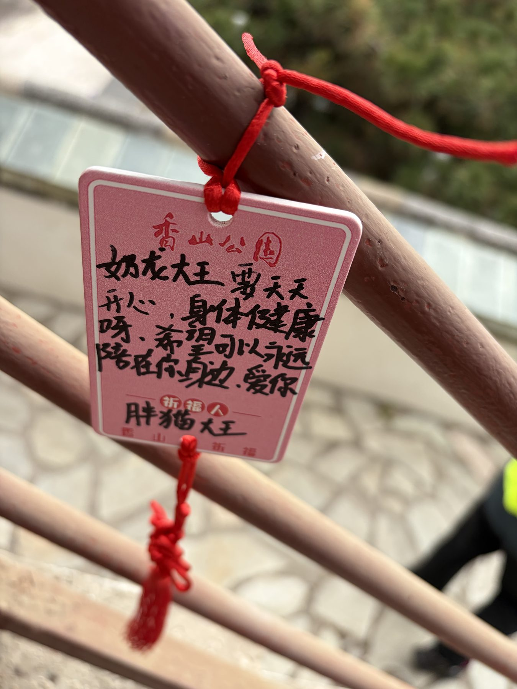
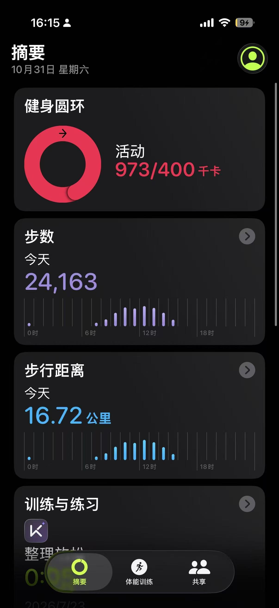
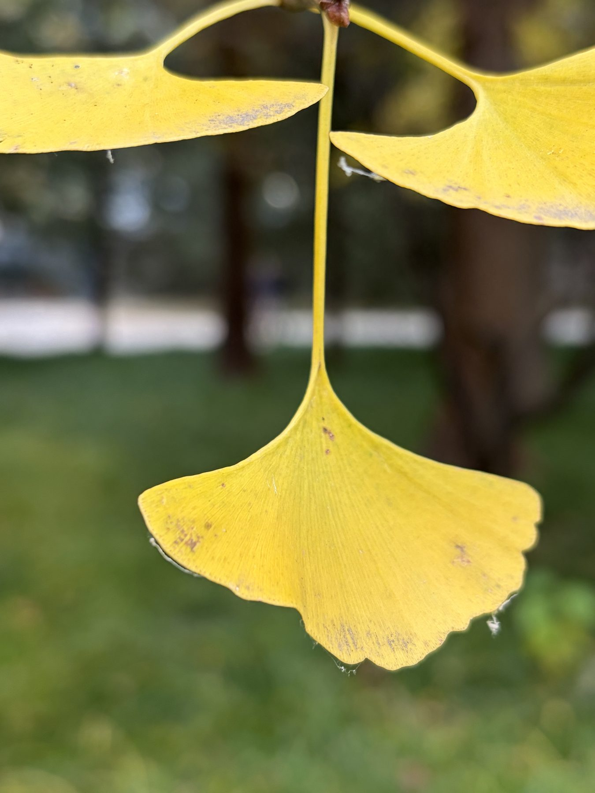
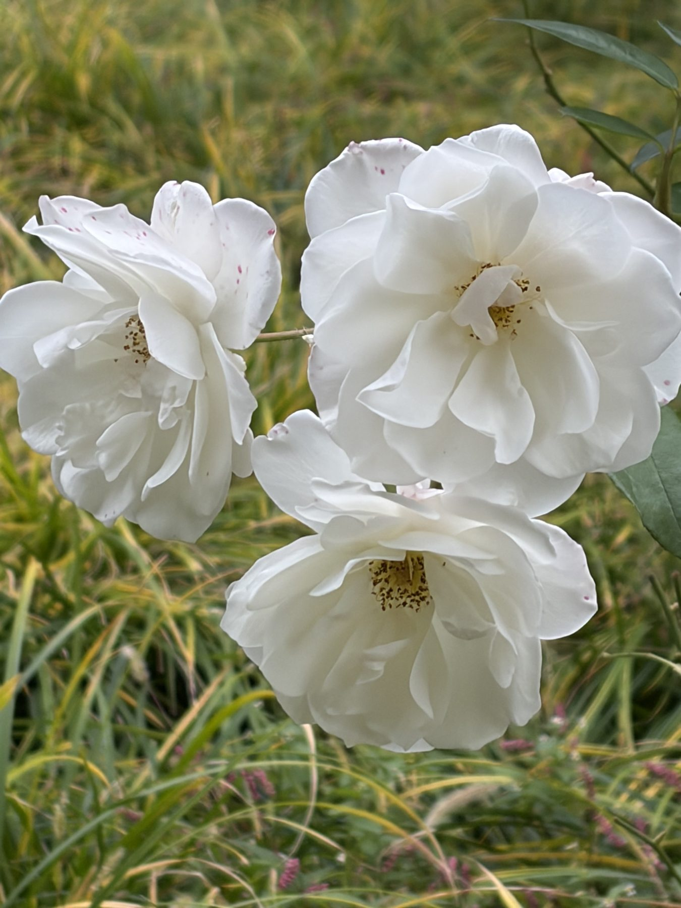
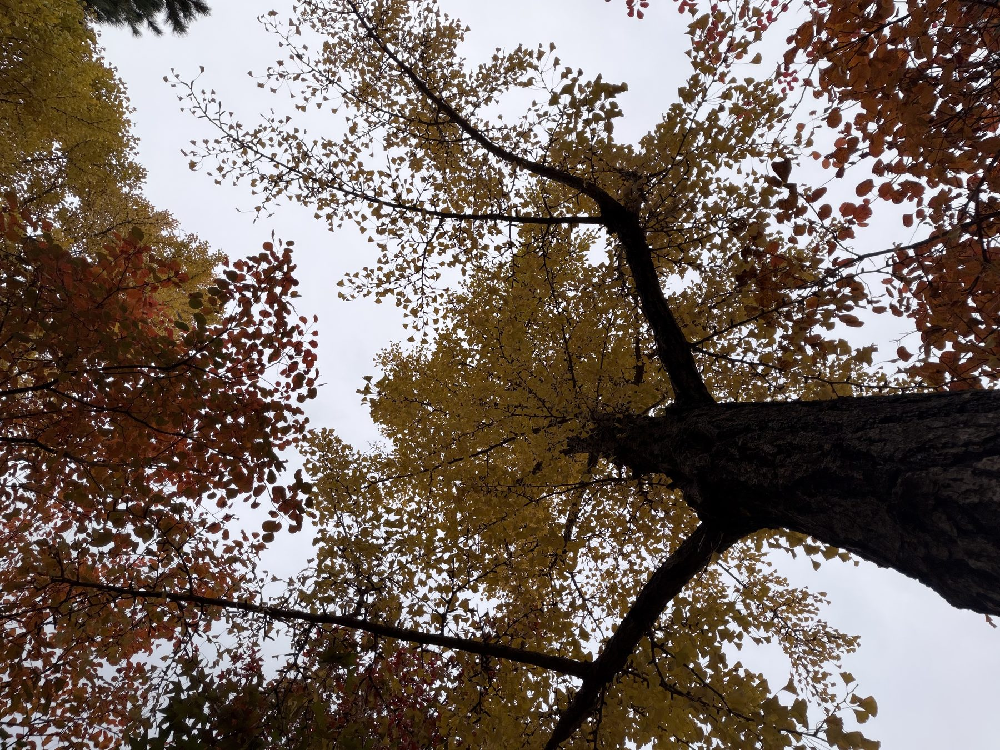
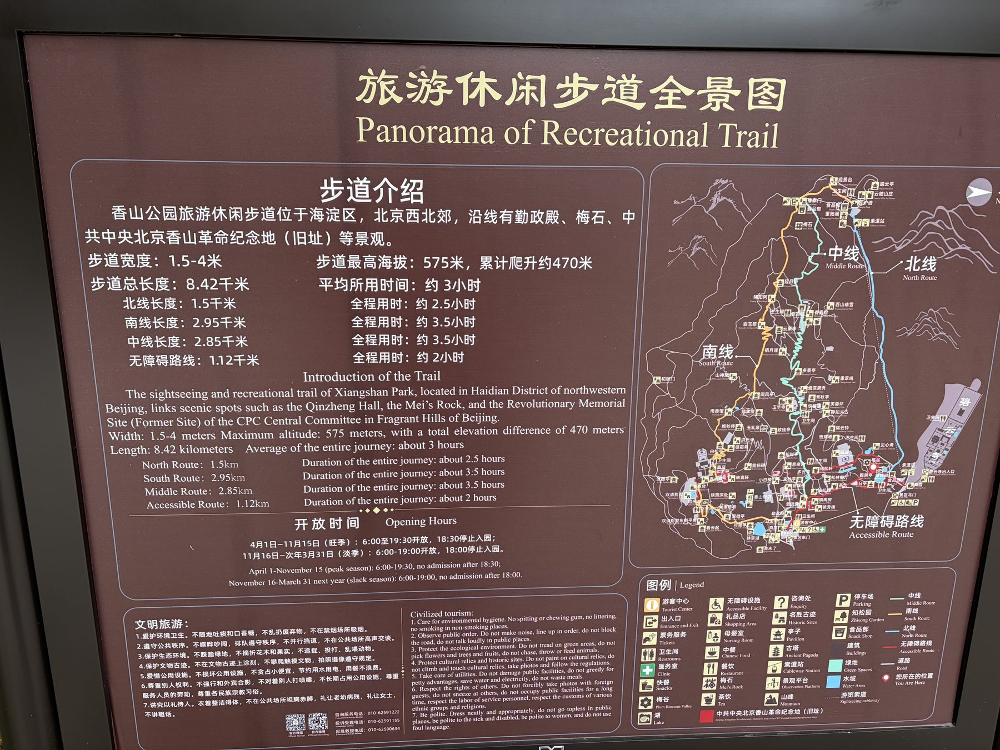
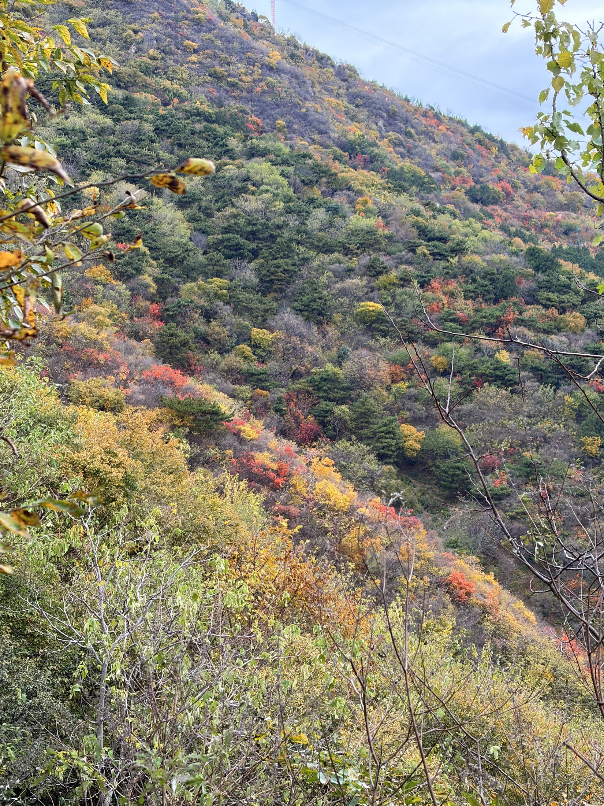
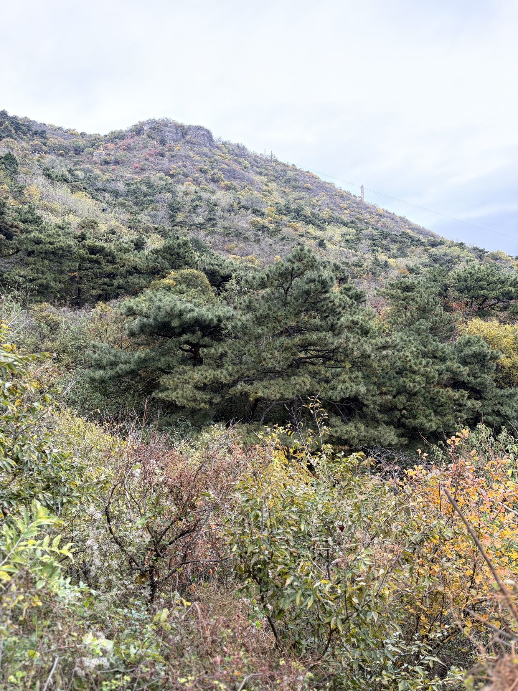

# 香山 · 一次秋日的登山

> 网页版：<https://joehongcn.github.io/xiangshan-diary/>

二〇二六年十月三十一日 · 北京

今天去了香山！

本来昨晚想着如果今天起的太晚就摆掉了，因为昨天下午喝了一杯咖啡，导致睡得挺晚的。结果今天7：20就醒了，遂“欣然起行”。

下面是一个目录（存疑）

- 你为什么应该去一趟香山
- 你为什么不应该去一趟香山
- 你应该怎么样收获一趟更好的去香山的旅程

## 你为什么应该去一趟香山

1、香山离市区并不大远，坐西郊线可以直接抵达。

2、香山是一个很好的自然景观，你可以在那里看到一个美丽的秋景。

3、有很多可爱的小鸟。

4、山顶的祈福区，有心的话，只要观看就能收获很多美好。

看哭了（

5、一个眺望北京市区的大好机会，尤其是在现在北京不给飞无人机的情况下。

6、收获一次足量的锻炼。

我第一次知道这个400kcal也能转两圈的

7、很多美景不用爬得很高就能看到。我甚至觉得在山下的几处风景就已经值回票价+通勤费了。

8、因为山就在那里。

## 你为什么不应该去一趟香山

1、通勤是麻烦的。尤其是在旅游旺季，去香山的人很多，从香山回来的人更多。如果你曾在广州生活过，你应该知道**地狱西路**的传说；不在也不要紧，今天下午回来的时候从开始排队到真正进站应该花了15min+，这样你应该也能对人流感受一二了。

2、北线是很累的，我估算了一下每一级台阶平均的高度在30cm+，而且不是那种平的台阶，其实就是一块块石头铺成的，梯度蛮大，我大概是爬100~200级台阶就要休息一下这样子，心率也是常在130左右。所以是否攀登北线*这个需要你自己衡量*。

3、几乎所有地图上标注的景点都很难称得上是有意思。这个有意思同时包括“好看”和“有文化底蕴”。我回来的时候骑车在北大逛了一圈，发现北大一些地方的景色并不亚于香山（暴论）。

4、大部分的时候你并不能看到一个美景。也就是说，这个美景是**不连续的**。这意味着你需要一双好的发现美的眼睛。

## 你应该怎样更好地收获一趟去香山的旅程

1、如果可以的话，骑自己的车去香山。如果乘地铁，尽量早点出发吧，然后尽量早点回来（当然错峰也是可以的）。

2、别走北线上山。尤其是现在北线其实是有挡板的，因为缆车在升级改造。想来之前游香山最省力的方法就是缆车吧，能同时收获北线的风光又不用付出登北线的汗水。更何况正如我前面提到的，北线是真的很吃体能。

你猜猜为什么北线只有1.5km（

3、如果觉得自己体能不够可以尝试使用登山杖来辅助。山下是有卖的，但是我不知道质量怎么样，所以提前备好是更好的选择。

4、有相机一定要带相机。限于设备我并不能很好地记录下我看到的所有美景。事实上，我大概率拍下了每一张我看到的美景，但是相机的记录和人眼还差的很远，离人心差的更远。很多时候我感觉到了一种“意境”，但是并不能记录下来。我觉得相机是一个很好的选择。

这张是比较典型的，当时看到的时候是真的被震撼到了。走在小路上，本来右边被一片杂树挡住，突然豁然开朗，露出一条黄、红色交织的树带。给人一种发自内心的愉悦。可惜手机记录不下当时的心境，只能尝试用文字记录了。

以及这几株松树。照片上看着一定是平平无奇的，只有亲自看到才能知道它们的肃穆与庄严。仿佛山一样压下来的一种感觉。

5、走走人少的“小路”。正如王安石在《游褒禅山记》写的那样：

> 夫夷以近，则游者众；险以远，则至者少。而世之奇伟、瑰怪，非常之观，常在于险远，而人之所罕至焉，故非有志者不能至也。
> —— 王安石《游褒禅山记》

香山有很多的美景并不在三条线上，这意味着有些时候你可能要横穿。也就是走一些甚至是*unpaved*的道路。不过不用担心难走，因为并不陡峭，而且其实地图上有标注。只是没有护栏，走的时候要小心。上面两张图片都是在小路上拍到的。

6、多多留心观察景色。多多回头。你可能一回头，就看见你走过的地方其实那么美。

7、放低对香山的期待。一般来说期待越高，你的*disillusionment*就越强。我们的2025年度番剧*Ave Mujica*已经证明了这一点，遑论更早的……
